# Earth Fly

A flight game on a full-size Earth that runs in the browser. Start over London, fly under Tower Bridge, climb to orbit, come back through the atmosphere, and try to stay alive near a carrier group.

**Play it: https://farikonsec.github.io/earth-fly/**

It needs a desktop browser with WebGL2. A phone works, but a keyboard is better.

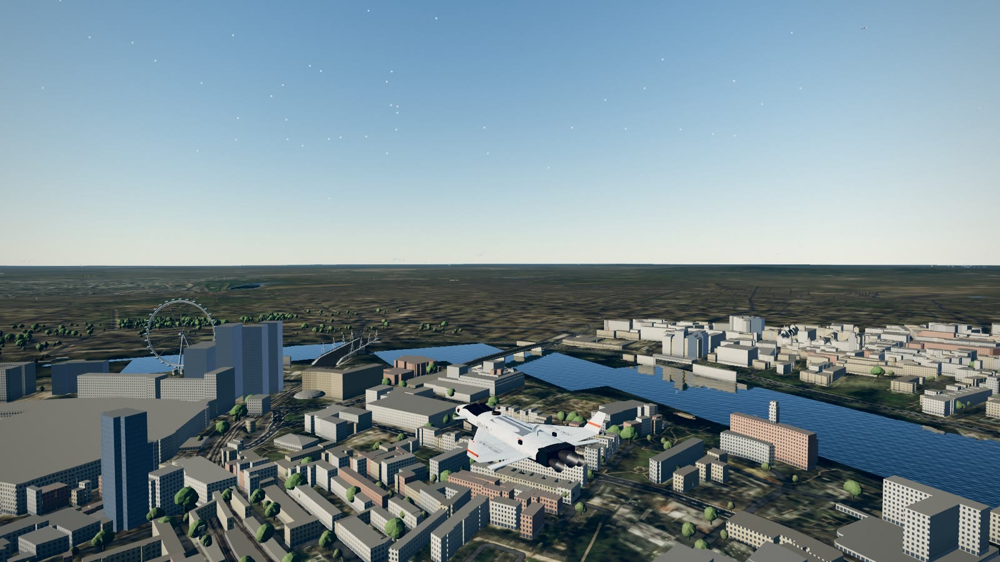

## What is in it

- One planet at true scale, 40,000 km around. You can fly from a street in London to a 400 km orbit without a loading screen.
- Central London in 3D: about 47,000 buildings, 35 bridges you can fly under, road and rail traffic, and ships on the Thames.
- Buildings, runways and trees for the rest of the world, streamed from open map data as you fly.
- Eight famous summits with finer terrain, including Everest, Denali, Kilimanjaro and Elbrus.
- Airliners on real routes and about 16,900 satellites on their real orbits, including the ISS.
- Dogfights, missile batteries, carrier groups, a bomber raid, and a nuclear bomb.

## Clips

| | |
|---|---|
| 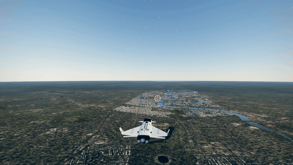 | 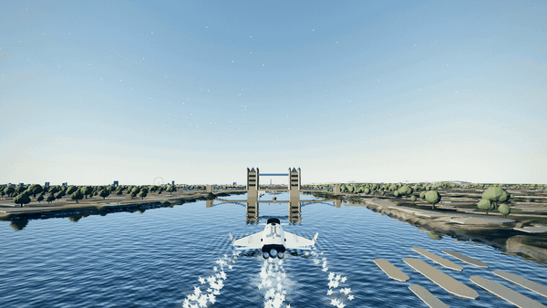 |
| A 150 kiloton burst: flash, shock ring, mushroom cloud | Under Tower Bridge at 95 m/s |
| 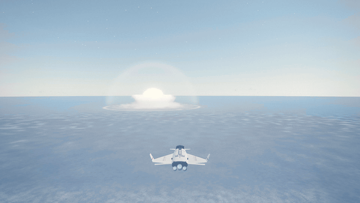 | 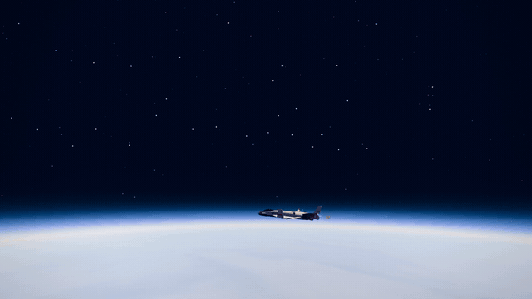 |
| The same bomb at sea: water column and ring waves | Coming back in at 7 km/s |
| 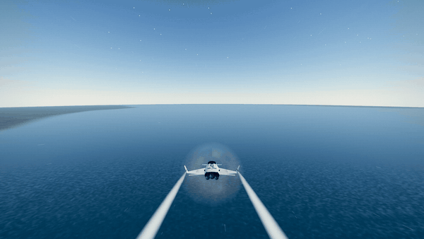 | 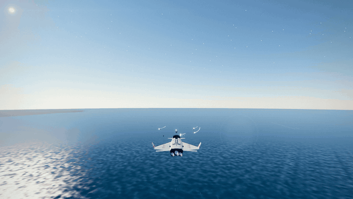 |
| Vapour disc at Mach 1 | A naval missile closing in |

Full-size MP4 versions are in [media/video](media/video).

## Screenshots

| | | |
|---|---|---|
| 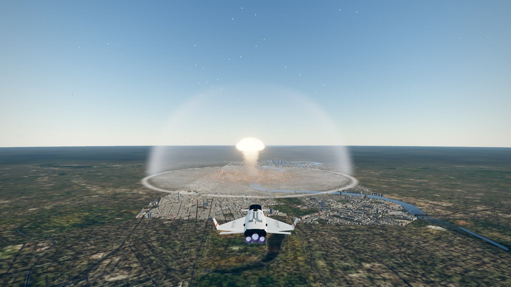 | 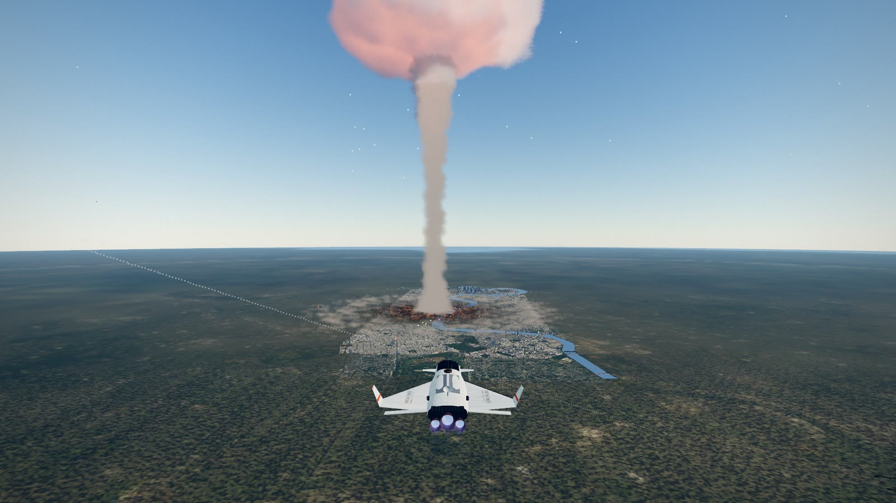 | 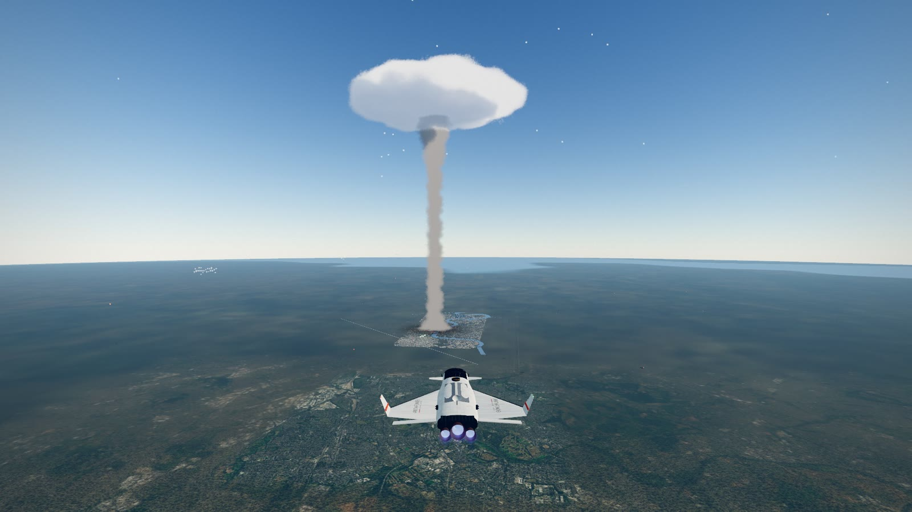 |
| Shock ring, 8 seconds in | The cloud at 100 seconds | Five minutes: 17 km high |
| 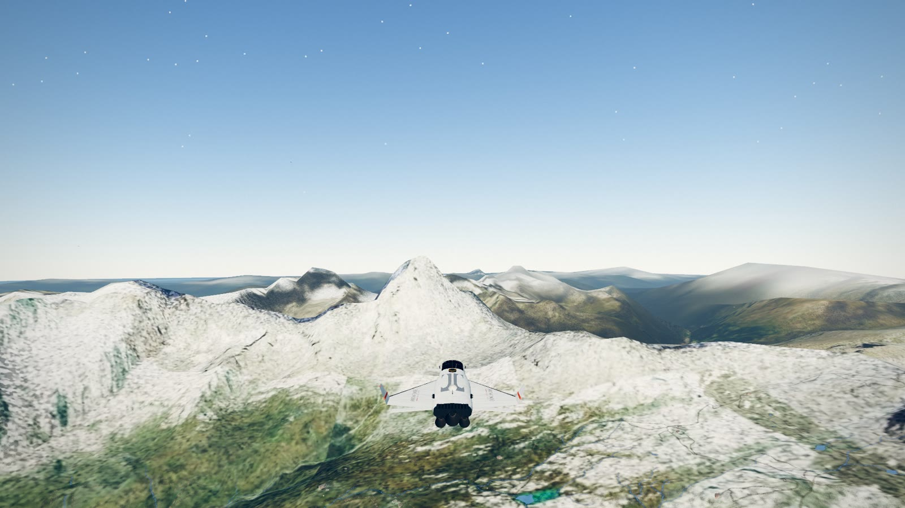 | 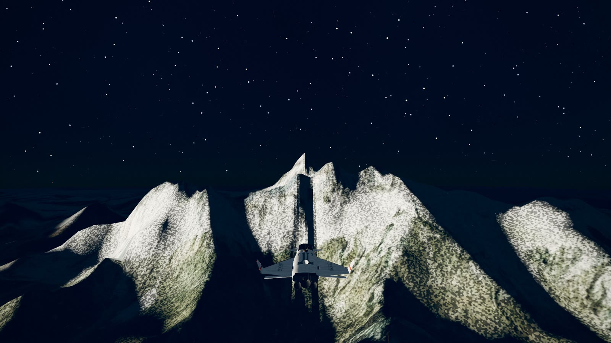 | 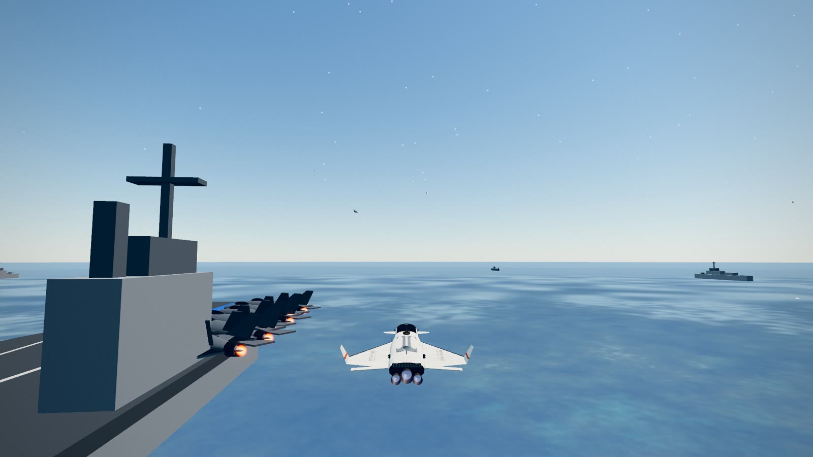 |
| The Matterhorn | The Everest massif by moonlight | On approach to a friendly carrier |
| 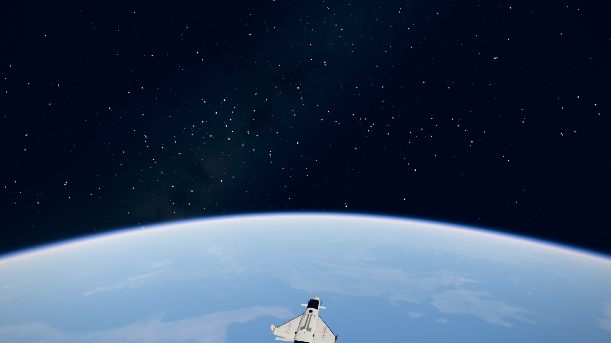 | 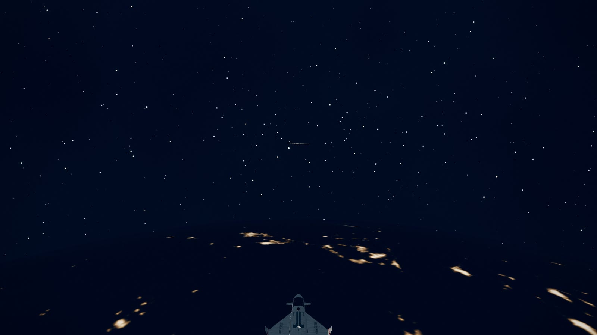 | 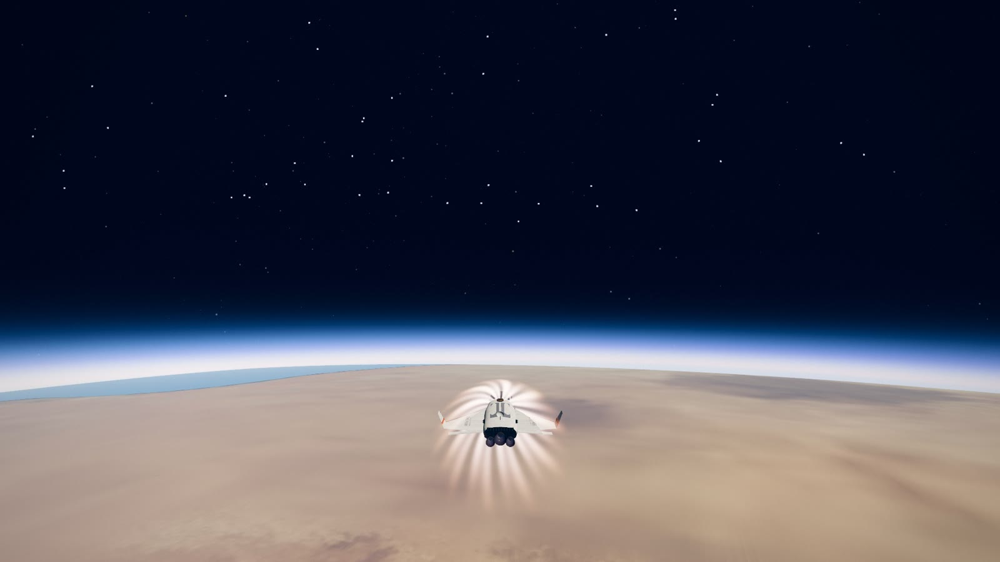 |
| Orbit at 400 km | Night side, on the ISS orbit | Plasma on the way down |

## How to play

Press Space to start. The aircraft flies itself level, so you only steer.

| Key | Action |
|---|---|
| W / S | Climb / dive |
| A / D | Bank left / right |
| Q / E | Yaw |
| Shift / Ctrl | Boost / airbrake |
| = / - | Throttle up / down |
| Y | Superspeed: a fictional drive for crossing continents and reaching orbit |
| G | Landing gear |
| V | Landing assist |
| R / F | Hover jets up / down |
| Z / X / C | Gun / missile / lock target |
| N | Drop the nuclear bomb |
| 1 to 8 | Camera views |
| H | Hide the interface |
| Space | Pause |

A gamepad and mouse steering also work. The Flight guide button in the game lists everything.

## Places

Open **Explore & Missions** to jump anywhere. Built-in starts include London and Heathrow, the Alps, the Grand Canyon, Torres del Paine, the Skeleton Coast, Everest, the Great Barrier Reef, Antarctica, Hawaii, Iceland, the Maldives, Mount Fuji, Milford Sound, Greenland, both poles, and the Caspian coast at Baku. You can also type any latitude and longitude, or start in orbit or on an entry path from 120 km.

## Missions

- **Bridges.** Fly under any of 35 bridges, or run ten Thames bridges in a row from Tower Bridge to Westminster against the clock.
- **Stop the White Swans.** Three Tu-160 and three Tu-95 bombers with six Su-27 escorts are flying to bomb London. Shoot every bomber down before they release. A raid sets out every 30 minutes even outside the mission.
- **Nuke the Red Fleet.** Sink a hostile carrier in the Channel. Its escorts shoot down anything they can track inside 45 km. Come in below 8 m, or faster than Mach 3.
- **Land on the carrier.** A friendly deck, 32 m above the sea.
- **Dogfight.** Waves of fighters with guns, rockets and seekers.

## The bomb

N drops one 150 kiloton bomb on a drag chute. A countdown shows the time to impact, then the time until the blast wave reaches you. Inside about 2 km it destroys the aircraft. On land it leaves a crater, burns the ground out to 2.6 km and flattens buildings out to 4.5 km. At sea it throws up a water column and ring waves. Drop it from above 5 km and turn away.

## Maps and data

Nothing here is live. Everything is a snapshot or a model.

- Global imagery: NASA Blue Marble. Close-up imagery is streamed from Esri World Imagery.
- Terrain: Mapzen / Tilezen terrain tiles, Copernicus DEM and ALOS AW3D30 for the summit regions, and Environment Agency LIDAR for central London.
- Buildings, roads and water: OpenStreetMap contributors (ODbL), with world tiles served by OpenFreeMap.
- Night lights: NASA Earth at Night 2012.
- Satellites: a CelesTrak snapshot of active objects, propagated with SGP4.
- Bomber models: ["Tupolev TU-160"](https://sketchfab.com/3d-models/tupolev-tu-160-d3af9e67f8024dcc9b23a3e91d492e40) by KOG_THORNS and ["Tupolev Tu-95 Bear"](https://sketchfab.com/3d-models/tupolev-tu-95-bear-ab58508d275d48adb84f4a0207a26c26) by Chenzoss, both [CC BY 4.0](https://creativecommons.org/licenses/by/4.0/). Changed: simplified, compressed and rescaled for the game. Files: [public/models/CREDITS.md](public/models/CREDITS.md).
- Full credits and licences: [public/textures/CREDITS.md](public/textures/CREDITS.md), [public/terrain/ATTRIBUTION.md](public/terrain/ATTRIBUTION.md), [public/scenery/README.md](public/scenery/README.md).

Aircraft, weapons, ships and the bomb are game models with made-up numbers. They are not simulations of real systems.

## Run it yourself

```bash
bun install
bun run dev
```

Then open http://127.0.0.1:5178. `bun run build` writes the static site to `dist/`, and `bun test` runs the physics and terrain tests.

Built with TypeScript, three.js and Vite. No game engine and no server: it is a static site.
